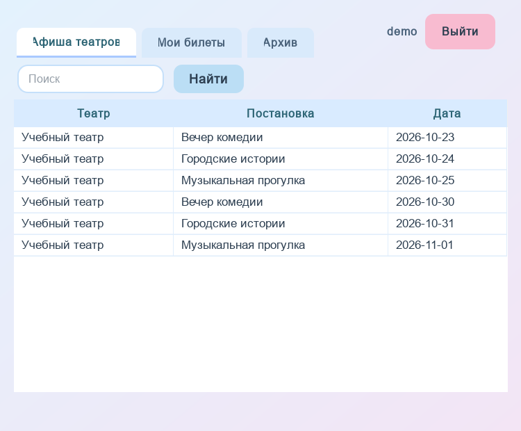

# Афиша театров

Учебное настольное приложение Симоны Бакич: афиша, оформление и возврат билетов, отзывы и добавление показов. **Python · PyQt5 · PostgreSQL**.

Проект вырос из курсовой работы по базам данных. Эта версия подготовлена для портфолио: сохранены формы исходного приложения, переработан доступ к БД, добавлены ограничения, транзакции, тесты и документация системного анализа. Данные демонстрации вымышленные.



## Возможности

- Зритель: регистрация и вход, поиск афиши, выбор категории места, оформление билета, история и возврат до начала показа, один отзыв на постановку с оценкой 1–10.
- Администратор: просмотр и поиск билетов, создание показа вместе с тремя категориями мест.
- PostgreSQL защищает последнее место от одновременной покупки. Возврат сохраняет билет со статусом `cancelled` и освобождает место в той же транзакции.
- Пароли хранятся как PBKDF2-SHA256 с индивидуальной солью; настройки подключения вынесены в `.env`.

## Запуск на Windows

Нужны Python 3.11+ и PostgreSQL 18 (локально или через Docker Compose).

```powershell
python -m venv .venv
.\.venv\Scripts\Activate.ps1
python -m pip install -r requirements.txt
Copy-Item .env.example .env
# В .env задайте свой локальный пароль БД. Для Docker оставьте PGPORT=55432.
docker compose up -d --wait
python setup_demo.py
python main.py
```

Для установленного PostgreSQL создайте **пустую отдельную** базу, укажите её реквизиты в `.env`, пропустите Docker. `setup_demo.py` отказывается устанавливать схему поверх существующих таблиц. Не запускайте его на базе курсовой.

Демонстрационные учётные записи: `demo / DemoPass2026`, `admin / AdminPass2026`. Это публичные учебные данные; не используйте их для реальных пользователей. Повторять `setup_demo.py` на заполненной базе не нужно.

## Проверка

```powershell
python -m pip install -r requirements-dev.txt
# Создайте отдельную пустую БД theater_portfolio_test с тем же владельцем.
$env:PGDATABASE='theater_portfolio_test'
python -m pytest -q
Remove-Item Env:PGDATABASE
```

Тесты работают только с именем базы, заканчивающимся на `_test`. Они проверяют конкуренцию за последнее место, возврат и его повтор, запрет чужого билета, откат счётчика при ошибке, атомарность создания показа, регистрацию и ограничения отзывов. Данные тестов остаются в отдельной базе.

## Документация

- [Роли, сценарии, требования и критерии приёмки](docs/system-analysis.md)
- [Схема и словарь данных](docs/data-model.md)
- [BPMN выдачи билета](docs/ticket-purchase.bpmn) и [изображение](docs/ticket-purchase.svg)
- [SQL-примеры](database/examples.sql)
- [Изменения относительно курсовой](docs/coursework-gap-analysis.md)
- [Проверки и известные ограничения](docs/validation.md)

`database/original_schema.sql` — выгрузка структуры исходной TheaterDB без данных. `database/schema.sql` — отдельная новая схема портфолио. Это не автоматическая миграция: персональные данные и старые пароли из исходной базы не переносились.

## Границы проекта

Это локальный учебный клиент с прямым подключением к PostgreSQL, а не публичный сервис. Разделение ролей действует в прикладном слое; пользователь, получивший реквизиты БД, находится вне этой границы доверия. Для многопользовательского развёртывания нужен сервер API с проверкой сессий и отдельными правами БД.

Нет платёжного шлюза, расчёта выручки, временной брони, нумерации кресел или подтверждения посещения. `active` означает невозвращённый билет, а архив определяется временем показа. Вместимости 50/30/20 — демонстрационные. Планирование пересечений показов по длительности и редактирование справочников пока не реализованы.

Доработка для портфолио выполнена с помощью AI-инструментов; исходный учебный проект и предметная область — работа автора. Результаты проверок приведены отдельно, без заявления о промышленной эксплуатации.
