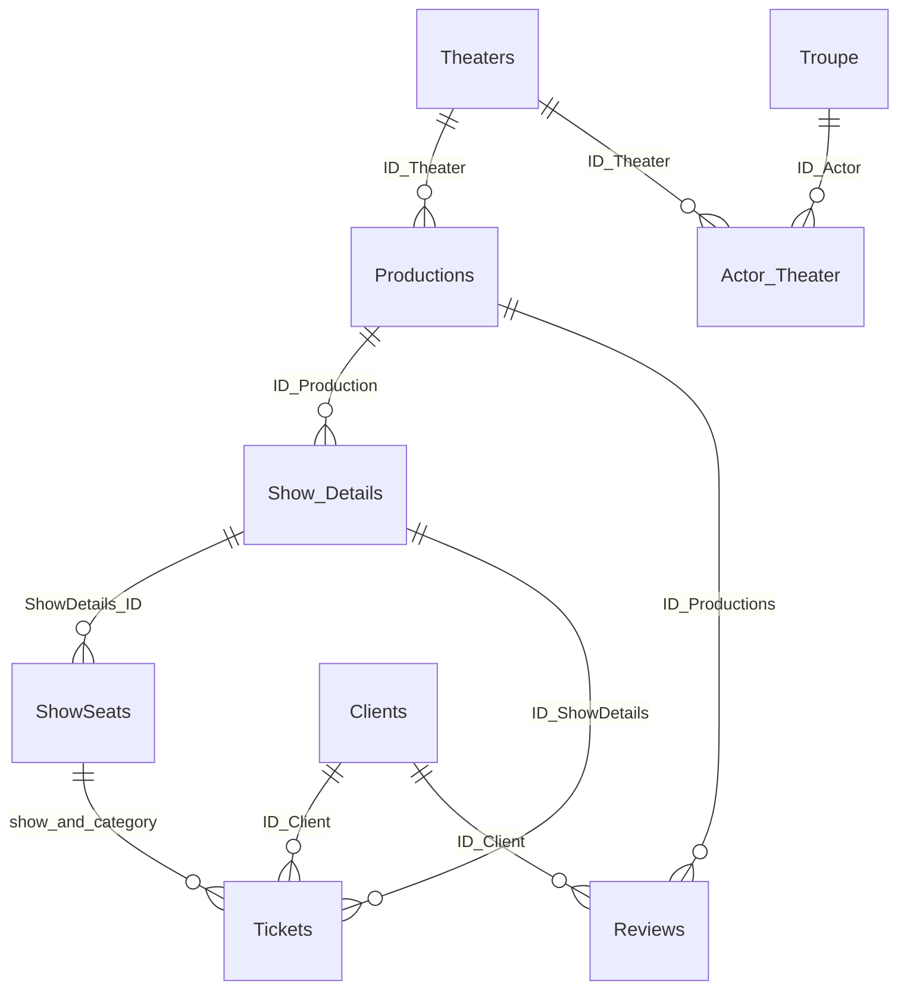

# Схема данных театрального приложения

Словарь сформирован по установленной схеме портфолио. 9 таблиц; две конкурирующие таблицы вместимости исходной версии удалены из новой модели. Исходная TheaterDB не изменена.

## Связи

Составной FK Tickets → ShowSeats проверяет пару (показ, категория), а UNIQUE не позволяет повторить категорию одного показа. Все перечисленные связи реализованы в PostgreSQL.

## Actor_Theater

Связь многие-ко-многим между актёрами и театрами.

| Поле | Тип | NULL | Значение по умолчанию |
|---|---|---|---|
| ID_Actor | integer | NO | — |
| ID_Theater | integer | NO | — |
| start_date | date | YES | — |

Ограничения:

- `FOREIGN KEY ("ID_Actor") REFERENCES "Troupe"("ID_Actor") ON DELETE CASCADE`
- `NOT NULL "ID_Actor"`
- `FOREIGN KEY ("ID_Theater") REFERENCES "Theaters"("ID_Theater") ON DELETE CASCADE`
- `NOT NULL "ID_Theater"`
- `PRIMARY KEY ("ID_Actor", "ID_Theater")`

## Clients

Учётные записи. Контакты необязательны; Password содержит только хеш.

| Поле | Тип | NULL | Значение по умолчанию |
|---|---|---|---|
| ID_Client | integer | NO | — |
| Login | text | NO | — |
| Password | text | NO | — |
| First_name | text | NO | ''::text |
| Second_name | text | NO | ''::text |
| Patronymic | text | YES | — |
| Phone_number | text | YES | — |
| Email | text | YES | — |
| is_admin | boolean | NO | false |

Ограничения:

- `UNIQUE ("Email")`
- `NOT NULL "First_name"`
- `NOT NULL "ID_Client"`
- `CHECK ((("Login" = lower(btrim("Login"))) AND ((length("Login") >= 3) AND (length("Login") <= 64))))`
- `UNIQUE ("Login")`
- `NOT NULL "Login"`
- `CHECK (("Password" ~~ 'pbkdf2_sha256$%'::text))`
- `NOT NULL "Password"`
- `UNIQUE ("Phone_number")`
- `NOT NULL "Second_name"`
- `NOT NULL is_admin`
- `PRIMARY KEY ("ID_Client")`

## Productions

Постановки конкретного театра. Actors — текст, не нормализованная связь с Troupe.

| Поле | Тип | NULL | Значение по умолчанию |
|---|---|---|---|
| ID_Production | integer | NO | — |
| Title | text | NO | — |
| Annotation | text | YES | — |
| Author | text | YES | — |
| Duration | integer | YES | — |
| Actors | text | YES | — |
| ID_Theater | integer | NO | — |
| Genre | text | NO | — |
| Image | text | NO | ''::text |

Ограничения:

- `CHECK (("Duration" > 0))`
- `NOT NULL "Genre"`
- `NOT NULL "ID_Production"`
- `FOREIGN KEY ("ID_Theater") REFERENCES "Theaters"("ID_Theater") ON DELETE RESTRICT`
- `NOT NULL "ID_Theater"`
- `NOT NULL "Image"`
- `UNIQUE ("Title", "ID_Theater")`
- `NOT NULL "Title"`
- `PRIMARY KEY ("ID_Production")`

## Reviews

Один отзыв клиента на постановку; оценка от 1 до 10.

| Поле | Тип | NULL | Значение по умолчанию |
|---|---|---|---|
| ID_Review | integer | NO | — |
| Review_content | text | NO | — |
| Assessment | integer | NO | — |
| Date_of_writing | date | NO | CURRENT_DATE |
| ID_Productions | integer | NO | — |
| ID_Client | integer | NO | — |

Ограничения:

- `CHECK ((("Assessment" >= 1) AND ("Assessment" <= 10)))`
- `NOT NULL "Assessment"`
- `NOT NULL "Date_of_writing"`
- `FOREIGN KEY ("ID_Client") REFERENCES "Clients"("ID_Client") ON DELETE RESTRICT`
- `NOT NULL "ID_Client"`
- `UNIQUE ("ID_Productions", "ID_Client")`
- `FOREIGN KEY ("ID_Productions") REFERENCES "Productions"("ID_Production") ON DELETE RESTRICT`
- `NOT NULL "ID_Productions"`
- `NOT NULL "ID_Review"`
- `CHECK (((length(btrim("Review_content")) >= 1) AND (length(btrim("Review_content")) <= 4000)))`
- `NOT NULL "Review_content"`
- `PRIMARY KEY ("ID_Review")`

## ShowSeats

Вместимость и счётчик активных билетов на показ и категорию. Счётчик обслуживает триггер.

| Поле | Тип | NULL | Значение по умолчанию |
|---|---|---|---|
| ID_ShowSeat | integer | NO | — |
| ShowDetails_ID | integer | NO | — |
| SeatType | text | NO | — |
| TotalSeats | integer | NO | — |
| SoldSeats | integer | NO | 0 |

Ограничения:

- `NOT NULL "ID_ShowSeat"`
- `CHECK (("SeatType" = ANY (ARRAY['партер'::text, 'бельэтаж'::text, 'балкон'::text])))`
- `NOT NULL "SeatType"`
- `UNIQUE ("ShowDetails_ID", "SeatType")`
- `FOREIGN KEY ("ShowDetails_ID") REFERENCES "Show_Details"("ID_ShowDetails") ON DELETE RESTRICT`
- `NOT NULL "ShowDetails_ID"`
- `NOT NULL "SoldSeats"`
- `CHECK (("TotalSeats" >= 0))`
- `NOT NULL "TotalSeats"`
- `CHECK ((("SoldSeats" >= 0) AND ("SoldSeats" <= "TotalSeats")))`
- `PRIMARY KEY ("ID_ShowSeat")`

## Show_Details

Конкретный показ постановки с датой, временем и залом.

| Поле | Тип | NULL | Значение по умолчанию |
|---|---|---|---|
| ID_ShowDetails | integer | NO | — |
| Show_Date | date | NO | — |
| Start_time | time without time zone | NO | — |
| Hall_number | integer | NO | — |
| ID_Production | integer | NO | — |

Ограничения:

- `CHECK (("Hall_number" > 0))`
- `NOT NULL "Hall_number"`
- `UNIQUE ("ID_Production", "Show_Date", "Start_time")`
- `FOREIGN KEY ("ID_Production") REFERENCES "Productions"("ID_Production") ON DELETE RESTRICT`
- `NOT NULL "ID_Production"`
- `NOT NULL "ID_ShowDetails"`
- `NOT NULL "Show_Date"`
- `NOT NULL "Start_time"`
- `PRIMARY KEY ("ID_ShowDetails")`

## Theaters

Справочник театров.

| Поле | Тип | NULL | Значение по умолчанию |
|---|---|---|---|
| ID_Theater | integer | NO | — |
| Title | text | NO | — |
| Contact_phone | text | NO | — |
| Address | text | NO | — |
| Number_of_halls | integer | NO | — |

Ограничения:

- `NOT NULL "Address"`
- `NOT NULL "Contact_phone"`
- `NOT NULL "ID_Theater"`
- `CHECK (("Number_of_halls" > 0))`
- `NOT NULL "Number_of_halls"`
- `UNIQUE ("Title")`
- `NOT NULL "Title"`
- `PRIMARY KEY ("ID_Theater")`

## Tickets

История билетов: active или cancelled. Стоимость и платёжные реквизиты отсутствуют.

| Поле | Тип | NULL | Значение по умолчанию |
|---|---|---|---|
| ID_Ticket | integer | NO | — |
| ID_Client | integer | NO | — |
| ID_ShowDetails | integer | NO | — |
| SeatType | text | NO | — |
| Status | text | NO | 'active'::text |
| CreatedAt | timestamp with time zone | NO | CURRENT_TIMESTAMP |
| CancelledAt | timestamp with time zone | YES | — |

Ограничения:

- `NOT NULL "CreatedAt"`
- `FOREIGN KEY ("ID_Client") REFERENCES "Clients"("ID_Client") ON DELETE RESTRICT`
- `NOT NULL "ID_Client"`
- `FOREIGN KEY ("ID_ShowDetails", "SeatType") REFERENCES "ShowSeats"("ShowDetails_ID", "SeatType") ON DELETE RESTRICT`
- `FOREIGN KEY ("ID_ShowDetails") REFERENCES "Show_Details"("ID_ShowDetails") ON DELETE RESTRICT`
- `NOT NULL "ID_ShowDetails"`
- `NOT NULL "ID_Ticket"`
- `NOT NULL "SeatType"`
- `CHECK (("Status" = ANY (ARRAY['active'::text, 'cancelled'::text])))`
- `NOT NULL "Status"`
- `CHECK (((("Status" = 'active'::text) AND ("CancelledAt" IS NULL)) OR (("Status" = 'cancelled'::text) AND ("CancelledAt" IS NOT NULL))))`
- `PRIMARY KEY ("ID_Ticket")`

## Troupe

Справочник актёров. В текущих формах отдельного редактора нет.

| Поле | Тип | NULL | Значение по умолчанию |
|---|---|---|---|
| ID_Actor | integer | NO | — |
| First_name | text | NO | — |
| Second_name | text | NO | — |
| Patronymic | text | YES | — |
| Education | text | YES | — |
| Experience | integer | YES | — |

Ограничения:

- `CHECK (("Experience" >= 0))`
- `NOT NULL "First_name"`
- `NOT NULL "ID_Actor"`
- `NOT NULL "Second_name"`
- `PRIMARY KEY ("ID_Actor")`

## Триггер и транзакции

`ticket_capacity_guard` вызывает `ticket_capacity()` перед INSERT, UPDATE или DELETE билета. INSERT резервирует ровно одно место условным UPDATE; UPDATE разрешает только возврат active → cancelled и уменьшает счётчик; DELETE запрещён. Любая ошибка откатывает весь запрос и связанные изменения. Прямое редактирование SoldSeats вне триггера не является поддерживаемым сценарием.

Покупка и возврат до начала показа проверяются по времени PostgreSQL. Часовые зоны клиента и базы должны совпадать. Отмена после начала не поддерживается.